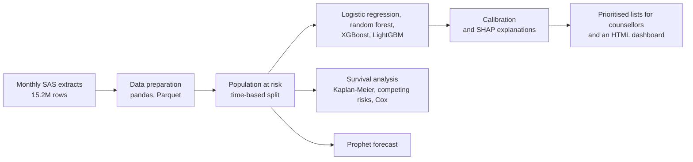
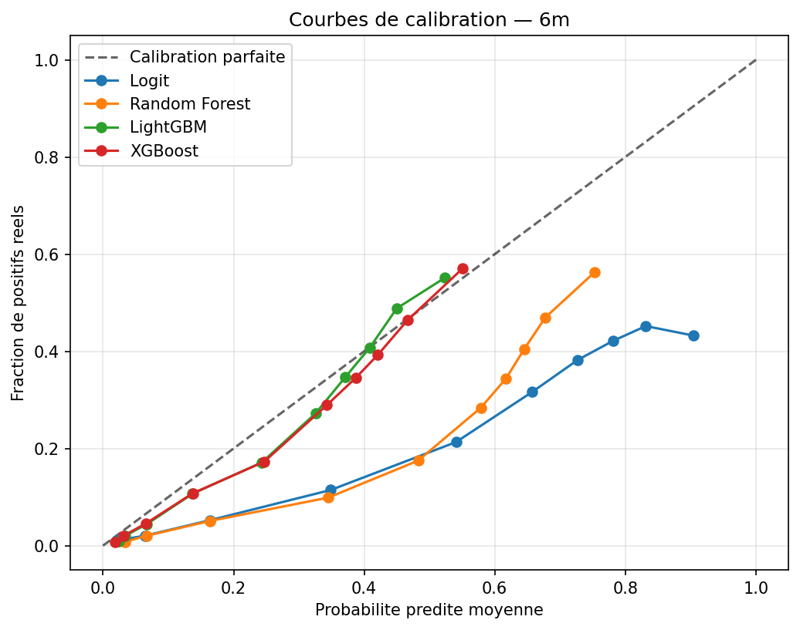
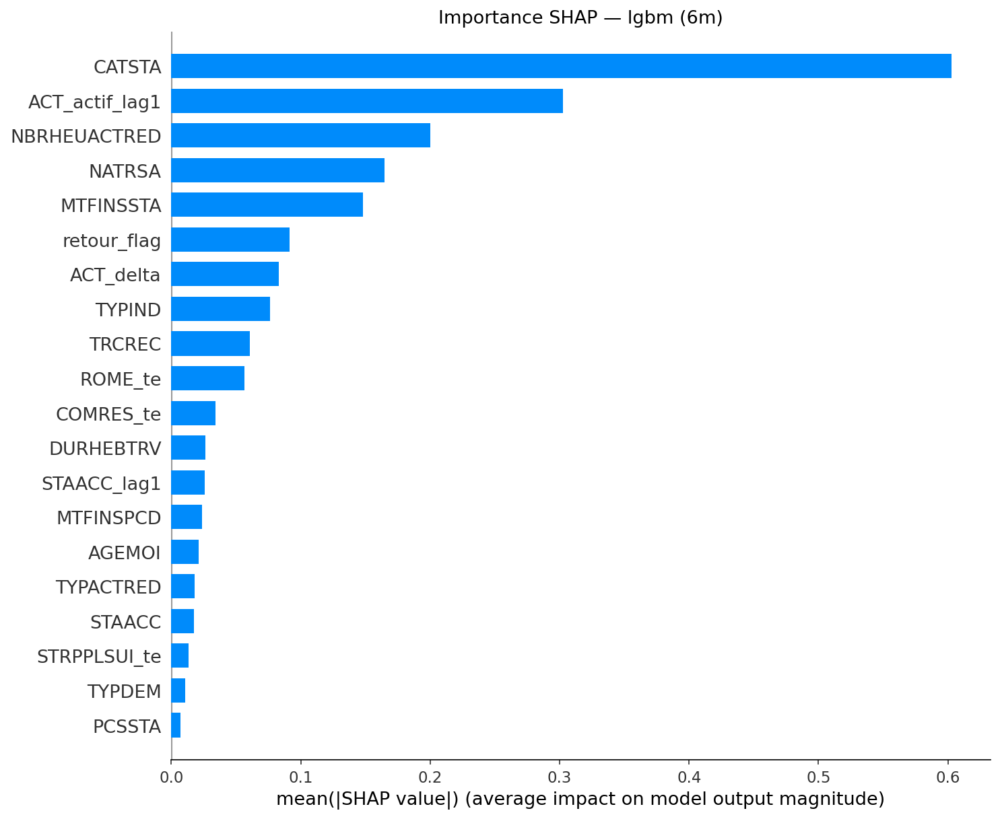
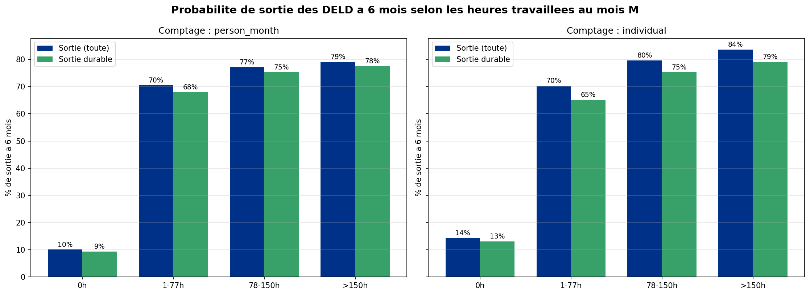
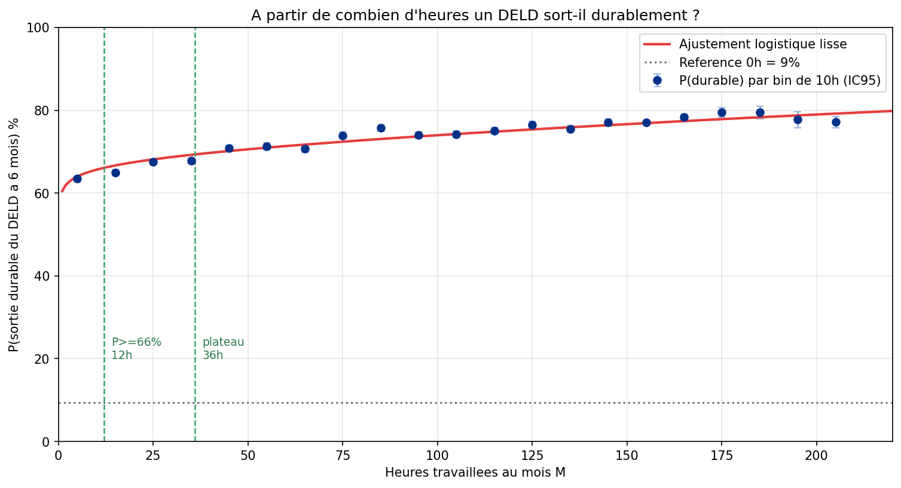
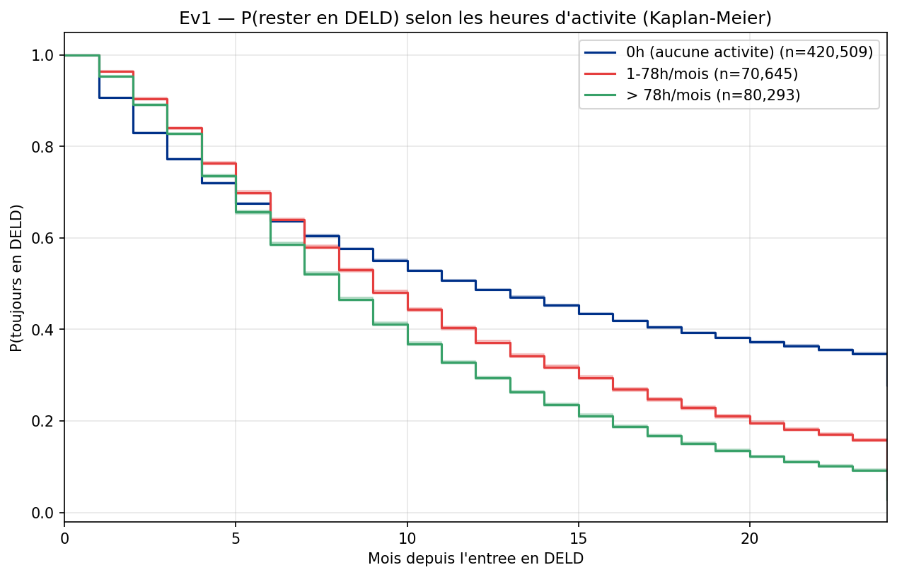
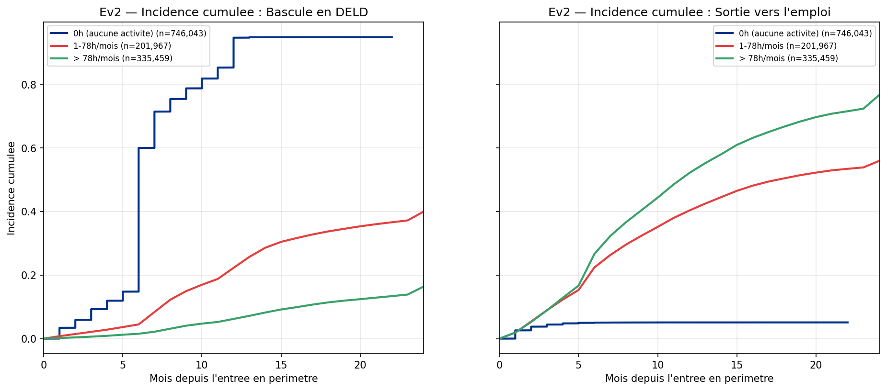

# Predicting long-term unemployment

Case study of a project I built for a regional directorate of France Travail, the French public employment service. The data and the source code are confidential, so this page only describes the problem, the approach and the aggregated results.

     

## Summary

| | |
|---|---|
| Data | 15.2 million monthly records, one row per jobseeker and month |
| Model | LightGBM, ROC-AUC of 0.80 at 6 months and 0.75 at 3 months, well calibrated |
| Evaluation | a target leak that pushed ROC-AUC to 0.93 was found and removed |
| Targeting | precision@10% from 0.48 to 0.55 with a model dedicated to the group closest to the threshold |
| Main finding | jobseekers who work even a few hours a month leave long-term unemployment far more often |

## The problem

In France, a jobseeker is counted as long-term unemployed after about 12 months without activity over the last 15. The regional management asked two questions:

1. Who is most likely to become long-term unemployed within 3 or 6 months, so that counsellors can step in earlier?
2. How does the chance of getting out of long-term unemployment change with the number of hours worked in a month?

I also added a 12-month forecast of the number of long-term unemployed in the region.

## Approach

The first version of the model scored an AUC of 0.93, which looked too good. Several variables were in fact rebuilding the time already spent without activity, which is exactly what defines the target. Once I removed them, the AUC dropped to between 0.75 and 0.80, and that is the model I kept.

The split is by time: training up to 2023, validation on the first half of 2024 and testing from mid-2024, so the model always predicts the future from the past. I judged the models on the group counsellors actually work with, using precision at the top of the list and calibration, because a global AUC computed on a mixed population says little about that group.

Among logistic regression, random forest, XGBoost and LightGBM, LightGBM ranked well and had the best calibration (lowest Brier score), which mattered because counsellors read the output as probabilities. A separate model for the group closest to the threshold improved the results where action is most useful. Each score comes with its three main SHAP drivers, so a counsellor can see why a person is flagged. I also tracked drift between the training and test periods with the population stability index.

For the question about hours worked, I derived the hour bands from the data (they line up with the regulatory half-time and full-time thresholds), drew a fine curve with Wilson confidence intervals, and broke it down by priority group and by département. The survival analysis has two parts. A Kaplan-Meier analysis follows people who are already long-term unemployed until they leave that status. A competing-risks analysis follows people at risk and compares two outcomes: becoming long-term unemployed, or leaving the at-risk group without becoming long-term unemployed, which I use as a proxy for a return to work.

The whole pipeline runs on a 16 GB laptop. Reading in chunks, using categorical types and float32, caching in Parquet and running each heavy step in its own process shrank the full table to 3.8 GB, against an estimated 20 GB or more with default types.

## Results

| Horizon | Evaluation population | ROC-AUC | PR-AUC | Brier |
|---|---|---:|---:|---:|
| 3 months | group closest to the threshold (base rate 31%) | 0.752 | 0.51 | 0.18 |
| 6 months | whole population at risk (base rate 24%) | 0.798 | 0.49 | 0.15 |

- The probability of a durable exit within 6 months goes from about 9% with no hours worked to about 63% with 1 to 10 hours. The gain then flattens: about 70% from around 40 hours, rising slowly to just under 80% for the highest hours.
- The effect is even stronger for jobseekers over 50.
- In the Cox model, more hours worked (on a log scale) lower the hazard of becoming long-term unemployed (HR 0.54) and raise the hazard of leaving the at-risk group (HR 1.32).
- The forecast was backtested on the last six known months, with a MAPE of 2.7%.

These results describe associations. People who already work a few hours are closer to employment to begin with, so the findings help target support; they do not prove that working more hours causes the exit.

| | |
|---|---|
|  |  |
| Calibration of the four models (6 months) | Global SHAP importance (LightGBM, 6 months) |
|  |  |
| Exit probability within 6 months by band of hours worked | From how many hours the exit becomes durable |
|  |  |
| Share still long-term unemployed over time, by hours worked | Competing risks: becoming long-term unemployed or leaving the at-risk group (labelled "sortie vers l'emploi" in the chart, used as a proxy for a return to work) |

The charts are in French, as delivered internally.

## Next steps

- Use the competing-risks survival model as the main predictive model, since it covers both questions at once.
- Retrain on a regular schedule and monitor drift automatically.
- Try separate 6-month models for each duration stage (6 to 9 and 9 to 12 months without activity).

## Stack

Python, pandas, PyArrow, scikit-learn, LightGBM, XGBoost, SHAP, lifelines, Prophet, matplotlib, Plotly, with SAS for extraction.

## Code

The code belongs to my employer and is not public. I am happy to walk through it in an interview.
